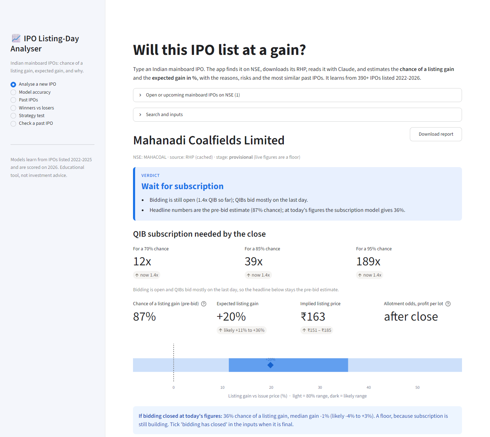
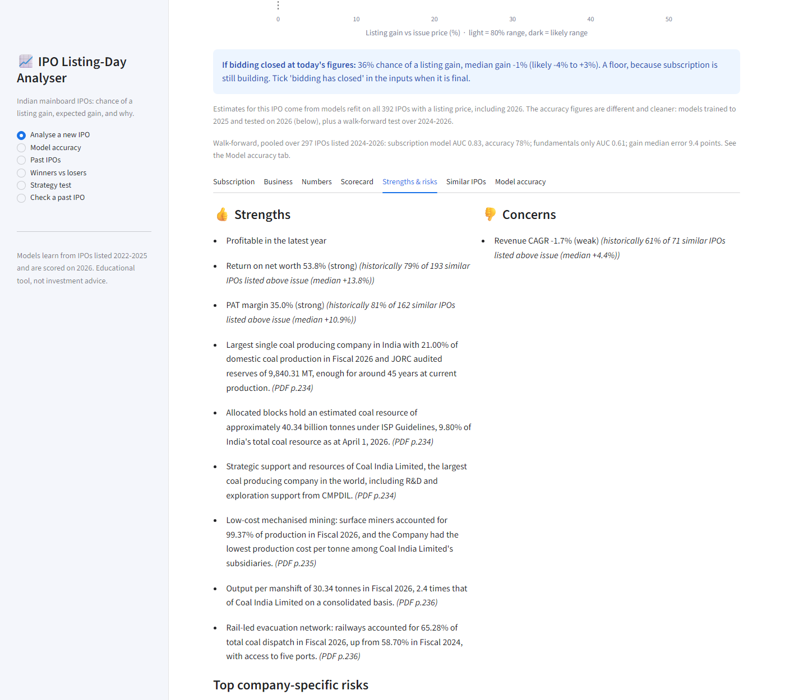

# IPO Listing-Day Analyser

**Will an Indian mainboard IPO list at a gain, and by how much?** Type the name of an IPO. The app finds it on NSE,
downloads its RHP, has Claude read it, and reports the chance of a listing gain, the expected gain in %, the likely listing
price, and the strengths, risks and most similar past IPOs behind that estimate.



|  |  |
|---|---|
| **Learns from** | 390+ mainboard IPOs listed 2022-2026 (NSE data, fundamentals read from each RHP) |
| **Tested by** | walk-forward: each of 2024, 2025 and 2026 scored by models trained only on earlier years (297 IPOs pooled) |
| **Chance of a gain, once subscription is final** | AUC 0.83, 78% accuracy pooled (a coin flip is 0.5; always saying "gain" is 72%) |
| **Expected gain** | median error 9.4 percentage points pooled; ranges widened so about 50% and 80% of outcomes fall inside |
| **Before bidding closes** | weak (pooled AUC 0.61), so the app keeps the pre-bid estimate as the headline while bidding is open and says so |

Educational tool, not investment advice. Models learn from past listings and can be wrong.



## Quick start

```bash
git clone https://github.com/singhwilliam15/ipo-listing-analyser
cd ipo-listing-analyser
python -m venv .venv && .venv\Scripts\activate        # macOS/Linux: source .venv/bin/activate
pip install -r requirements.txt
streamlit run app.py
```

The repo ships with the dataset (`data/ipos.csv`), so the model pages and backtest work straight away. Looking up a live IPO
needs two things: a connection NSE accepts (home internet works; most cloud servers and VPNs are blocked), and a way to read
the RHP, either `ANTHROPIC_API_KEY` or the Claude Code CLI (`claude`) logged in. Without either you can still explore the
history, the backtest and the model-accuracy pages.

## Analyse a new IPO

Open the app, pick **Analyse a new IPO**, type a name or NSE symbol (for example `Mahanadi Coalfields`), and press Analyse.
The app finds it on NSE and downloads the RHP automatically (or use the upload box if NSE is blocked or has no link). Claude
reads the RHP, and the code does all the maths. The report has eight sections:

1. **Verdict**: Apply / Apply with caution / Skip / Wait for subscription, with reasons.
2. **Listing chance and expected gain**: P(listing above issue price), the expected gain with likely and 80% ranges, the
   implied listing price, allotment odds, expected profit per lot, and the QIB subscription needed for a 70/85/95% chance.
   A stage label shows whether the number is pre-bid, provisional (live bidding, a floor) or final.
3. **Subscription** by category, and how past IPOs listed at each subscription band.
4. **The business**: summary, segments, concentration, industry, promoters (second Claude pass, page number on every point).
5. **Key numbers**: valuation vs peers, financials, use of fresh money, selling shareholders.
6. **Scorecard** per pillar as a percentile rank against all past IPOs.
7. **Strengths, concerns, risks**, litigation, contingent liabilities, related-party items and red flags.
8. **The 10 most similar past IPOs.**

While bidding is open the headline is the pre-bid estimate; the subscription model's answer appears separately as "if bidding
closed at today's figures", next to the QIB subscription needed for a 70/85/95% chance. Allotment odds and profit per lot appear
once you tick "bidding has closed" (you can also type subscription figures yourself, which override NSE's live numbers). The
report downloads as Markdown.

Accuracy is shown on the **Model accuracy** tab: a walk-forward test over 2024-2026 and the published train-to-2025 / test-2026
result, both in [docs/findings.md](docs/findings.md). Estimates for a live IPO use models refit on every row including 2026;
the accuracy figures come from models that never saw their test years.

## Logging live subscription

`python -m src.build snapshot` appends NSE's category-wise subscription (QIB, NII, retail, employee and shareholder quotas)
for every open issue to `data/snapshots.csv`, with a timestamp. It is safe to run from cron every 30 minutes: runs cannot overlap
(lock file), a row is written only when NSE's own "updated as on" stamp has changed, and NSE errors are logged, not raised.

```
*/30 9-17 * * 1-5  cd /path/to/ipo-analyser && .venv/bin/python -m src.build snapshot
```

## Setup

Needs Python 3.10+.

```bash
cd ipo-analyser
pip install -r requirements.txt
python -m pytest                       # offline tests, no API calls
streamlit run app.py                   # works straight away with synthetic demo data
```

RHP extraction calls Claude. Set `ANTHROPIC_API_KEY`; without one the app falls back to the Claude Code
CLI (`claude`) and your plan login. NSE blocks most cloud and VPN IPs, so live lookups work best from a home connection;
a hosted copy would need the data and extraction handled separately.

## Building the dataset

Run these from the `ipo-analyser` folder, from a normal connection in India, because NSE blocks
most cloud and VPN IPs. Every step can be stopped and re-run; it picks up where it left off.

```bash
python -m src.build issues               # NSE past issues since Oct 2021  -> data/issues.csv
python -m src.build outcomes             # listing-day OHLC from Yahoo      -> data/outcomes.csv
python -m src.build demand               # NSE bid data, RHP links          -> data/demand.csv
python -m src.build market               # Nifty 50 and India VIX           -> data/market.csv
python -m src.build rhp                  # download RHP PDFs                -> rhp/<SYMBOL>.pdf
python -m src.build extract --estimate   # token and cost estimate, no API calls
python -m src.build extract --limit 10   # try 10 first and check them by hand
python -m src.build extract              # the rest                         -> data/raw/<SYMBOL>.json
python -m src.build assemble             #                                  -> data/ipos.csv, data/ipos_sme.csv
python -m src.build analyse              # report                           -> data/report_target_gain.md
```

Useful flags:
- `extract --year 2026` or `extract --symbols ABC XYZ` to work on a subset.
- `extract --force` to redo an RHP.
- `analyse --target target_gain_5` to ignore flat listings.
- `analyse --quality full` to use only fully checked rows.

### How RHP extraction works

1. `pdfplumber` reads the text of every page of the 300–600 page RHP.
2. A keyword scorer keeps about 40 relevant pages and skips the table of contents: offer
   details, capital structure, objects of the offer, restated financials, basis for offer price
   and lead managers.
3. Claude (`claude-opus-5-5`) returns each figure **exactly as printed**, with its unit (₹ million
   / lakh / crore) and page number, using a fixed schema (structured outputs). All unit
   conversion and every ratio is calculated in code, not by the model.
4. Reconciliation checks flag likely errors, such as PAT larger than revenue, revenue jumping 50x
   between years, EPS that doesn't match PAT ÷ shares, or a retail quota that isn't 10 or 35.
   Any IPO with a failed check is marked `data_quality = partial`.

`data/raw/<SYMBOL>.json` holds the converted values, `rhp_page_<field>` for every figure, the
pages that were sent, token usage, and the full raw extraction. That makes every number
traceable to a page.

**Cost:** about 40 pages ≈ 40–60k input tokens and ~5k output tokens per RHP, or roughly
$0.25–0.35 per IPO at Opus 5.5 prices. `extract --estimate` prints the figure for your actual
PDFs before you spend anything.

## Data that needs a hand

Some fields have no reliable public historical source. Add them, along with any corrections,
to `data/manual/overrides.csv`, one value per row (`symbol,field,value,note`). Overrides win
over every automatic source.

| Field | Why it's manual |
|---|---|
| `gmp_last_rs` | GMP is unofficial; there's no historical archive. Record the source in `note`. |
| `anchor_cr` | Comes from the anchor allotment notice on the exchange, not the RHP. |
| `rhp_url` | When NSE's detail page has no RHP link. SEBI: sebi.gov.in → Filings → Public Issues. Or just save the PDF as `rhp/<SYMBOL>.pdf`. |
| `sub_*_x` | NSE doesn't keep bid data for every older issue. |
| anything else | Any value the extractor got wrong. Check `data/raw/<SYMBOL>.json` for the page number. |

Never edit the derived columns in `ipos.csv` by hand; they are recomputed on every `assemble`.

## Analysis rules

- **Split by listing date:** train = 2022-01-01 to 2025-12-31, test = 2026 onward. Rules, thresholds,
  model weights and feature choice all come from training rows only. A test in
  `tests/test_analyse_and_fetch.py` scrambles the 2026 outcomes and checks that nothing changes.
- **Reported first:** the base rate, i.e. the share of IPOs that listed above issue price.
- **Baselines a strategy must beat:** (a) always apply; (b) apply if total subscription > 10x.
- **Outputs:**
  - Winners-vs-losers comparison per feature (medians, share above the median, Mann–Whitney p).
  - The best single thresholds.
  - A greedy rule set of up to 3 conditions.
  - A logistic regression.
  - Accuracy / precision / recall / confusion matrix and the average listing gain of the IPOs each
    strategy would have picked, on 2026.

## Layout

```
data/ipos.csv              final mainboard dataset (schema: src/schema.py)
data/ipos_sme.csv          same schema, SME issues
data/raw/<SYMBOL>.json     RHP extraction with page refs
data/manual/overrides.csv  hand-entered values and corrections
rhp/<SYMBOL>.pdf           RHP PDFs (git-ignored)
src/schema.py              every column: type, group, source
src/fetch_market.py        NSE client + parsers, Yahoo prices, Nifty/VIX
src/extract_rhp.py         PDF -> pages -> Claude -> raw JSON, unit conversion, checks
src/features.py            derived fields, market context, targets, data quality
src/analyse.py             group comparison, rules, logistic regression, metrics
src/build.py               the CLI above
src/demo.py                synthetic rows for tests and the demo toggle
src/report.py               probability, gain ranges, walk-forward backtest, report assembly
src/snapshot.py             live subscription logger for cron
src/qualitative.py          second Claude pass: business, risks, litigation (page-referenced)
src/live.py                 NSE lookup, RHP download, feature row for a new IPO
app.py                     Streamlit front end (display only)
```

## Known limits

- NSE's JSON API is undocumented. The parsers look fields up by several aliases, but if NSE
  renames something, a column will come back empty rather than wrong. Check
  `data/nse_detail/<SYMBOL>.json` and adjust the aliases in `fetch_market.py`.
- Yahoo sometimes has no history under the NSE symbol, for example when a company renamed after
  listing. Those rows get a note in `data/outcomes.csv`; add `list_open` / `list_close` as overrides.
- Scanned RHPs without a text layer are rejected. Run OCR on them (for example with `ocrmypdf`) and
  re-run `extract`.
- A few hundred IPOs is a small sample. Expect simple rules to hold up better than complex models,
  and treat any 2026 result from fewer than ~50 IPOs as a rough indication.

Educational tool, not investment advice.
